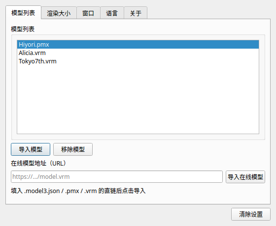

# PPet（C++ 重写版）

> 基于 [zenghongtu/PPet](https://github.com/zenghongtu/PPet) 思路，用 **C++17 + OpenGL/GLFW** 从零重写的桌面宠物。
> 保留「透明置顶窗口 + 系统托盘 + 鼠标跟随」的桌面挂件体验，并带来三大增强：
> **全屏追踪**、**VRM 模型支持**、**PMX 模型支持**。

本项目是原生桌面程序（无 Electron、无浏览器运行时），启动快、内存占用低，并能在全屏游戏/应用中持续跟随光标。

---

## 特性

- **全屏追踪（Fullscreen Tracking）**：通过操作系统级 API 获取**整个虚拟桌面**的光标位置，模型眼睛/头部不再局限于自身窗口内跟随鼠标（解决原版 issue #26 / #122 / #158）。
- **多模型格式**：
  - **VRM 1.0 / 0.x**（glTF 容器，MToon 卡通渲染、表情 morph、弹簧骨、LookAt 视线追踪）
  - **PMX 2.0 / 2.1**（顶点蒙皮、骨骼、材质、表情变形）
  - **Live2D**（可选后端，见下文）
- **透明置顶窗口**：真·透明叠加层，支持点击穿透、窗口拖动、缩放。
- **系统托盘菜单**：置顶 / 忽略点击 / 显示工具栏 / 切换模型 / 语言 / 开机启动 / 反馈 / 关于 / 退出。
- **设置面板（Qt 6）**：模型管理、渲染缩放、全屏追踪参数、语言切换。
- **中英双语**：界面文案随托盘菜单的语言选项切换。
- **开机启动**：跨平台注册表 / LaunchAgent / autostart 桌面项。
- **健壮的解析器**：所有模型文件读取都做了边界检查与索引越界防护，并配套 ASAN 模糊测试。

---

## 模型格式支持

| 格式 | 扩展名 | 状态 | 说明 |
|------|--------|------|------|
| VRM 1.0 | `.vrm` | ✅ 默认支持 | GLB/glTF2.0，含 MToon、humanoid、expressions、springBone |
| VRM 0.x | `.vrm` | ✅ 默认支持 | `extensions.VRM` 单体扩展，向后兼容 |
| PMX 2.0/2.1 | `.pmx` | ✅ 默认支持 | 二进制，含骨骼蒙皮、材质、变形、显示帧 |
| Live2D | `.model3.json` | ⚙️ 可选 | 需自行下载 Cubism SDK（专有许可），放入 `src/csdk/` 即自动启用 |
| 模型压缩包 | `.zip` | ✅ 默认支持 | 自动解压并定位包内模型（`.model3.json` / `.pmx` / `.vrm`） |

> 三种格式在内部统一转换为「蒙皮网格 + toon 着色」表示，共用同一套渲染管线。

### 压缩包导入（.zip）

社区里的 Live2D / MMD 模型通常以 `.zip` 形式分发（一个包内含模型主文件 + 贴图 + 动作）。
本项目支持直接导入 `.zip`：

- 导入时自动解压到缓存目录（Windows：`%APPDATA%\PPet\models`；Linux/macOS：配置目录同级）；
- 自动在包内定位模型主文件，优先级：`.model3.json` > `.pmx` > `.vrm`；
- 贴图、动作等相对路径资源随包一起解压，模型加载时按原目录结构解析；
- 重复导入同一个包会覆盖旧缓存，不会残留过期文件。

> Cubism 2 的老格式（`.moc` + `.model.json`）**不在支持范围内**——Cubism 5/6 的 Core 只认 `.moc3`。
> 请先用 Live2D Cubism Converter 把模型转换为 `.moc3` 格式再导入。

### 中文路径支持

Windows 上模型的路径经常带中文（下载目录、模型包名都可能是中文）。
这里对路径处理做了统一加固，Windows / Linux / macOS 行为一致：

| 环节 | 处理方式 |
| --- | --- |
| 文件读写 | Windows 走 `CreateFileW` 宽字符 API（不经过 ANSI 代码页），Linux/macOS 直接用窄字符 |
| 目录遍历 / 建目录 | `std::filesystem::path` 统一由 `ToFsPath()` 从 UTF-8 构造，Windows 上显式转 UTF-16 |
| 路径回写（存配置、日志） | 统一由 `FromFsPath()` 转回 UTF-8，避免「读得到、存回去变乱码」 |
| 环境变量（`%APPDATA%` / `$HOME`） | Windows 用 `GetEnvironmentVariableW` 宽字符接口，再转 UTF-8 |
| ZIP 条目名 | 按 UTF-8 标志位（bit 11）判定；未置位但字节本身是合法 UTF-8 时也按 UTF-8 解析，否则按系统 ANSI 代码页解码 |

> MSVC 的 `std::filesystem::path` 从窄字符串构造时按 **ANSI 代码页**（中文系统即 GBK）解释字节，
> 与 MinGW 行为不同。本项目不直接用 `fs::path(std::string)`，而是通过上表的辅助函数显式转换，
> 因此两种编译器表现一致。

---

## 构建

### 依赖

- **编译器**：支持 C++17 的 GCC / Clang / MSVC
- **构建系统**：CMake ≥ 3.16
- **图形**：OpenGL（桌面 OpenGL 3.3 核心）、[GLFW](https://www.glfw.org/)、[GLEW](https://glew.sourceforge.net/)
- **界面**：[Qt 6](https://www.qt.io/)（Widgets 模块，设置面板用 `QDialog` 实现，需通过包管理器或 Qt 官方安装器安装）

#### Linux（Ubuntu / Debian）

```bash
sudo apt-get update
sudo apt-get install -y build-essential cmake pkg-config \
    libglfw3-dev libglew-dev libgl1-mesa-dev libglu1-mesa-dev \
    libx11-dev libxrandr-dev libxi-dev libxcursor-dev libxinerama-dev \
    libxext-dev libxft-dev libfontconfig1-dev libssl-dev
# 可选：无头环境下跑图形测试
sudo apt-get install -y xvfb
```

#### Windows

使用 vcpkg 或 MSYS2 安装 `glfw3`、`glew`，并准备 Visual Studio（含 C++ 桌面开发负载）。

```powershell
vcpkg install glfw3 glew
```

#### macOS

```bash
brew install cmake glfw glew
```

### 编译步骤

```bash
git clone https://github.com/XaryLight/PPet-RE.git
cd PPet-RE
cmake -S . -B build -DCMAKE_BUILD_TYPE=Release
cmake --build build -j
```

产物：

- `build/bin/ppet` —— 主程序
- `build/bin/ppet_*_test` / `build/bin/ppet_*_smoke` —— 测试程序

### 启用 Live2D 后端（可选）

Live2D Cubism SDK 为**专有许可软件，不可随本仓库分发**。若要支持 Live2D（`.model3.json`）模型，用的是 **Cubism SDK for Native** 的 **Core 层**：

1. 从 <https://www.live2d.com/en/sdk/download/> 下载 **Cubism SDK for Native**（只需其中的 **Core** 目录）；
2. 把 **Core 目录**放到 **`src/csdk/`**（或 `third_party/Cubism/`，或用 `-DPPET_CUBISM_ROOT=<目录>` 指定），最终结构应含：
   - `src/csdk/Core/include/Live2DCubismCore.h`
   - `src/csdk/Core/lib/linux/x86_64/libLive2DCubismCore.a`（Linux）
   - `src/csdk/Core/lib/macos/libLive2DCubismCore.a`（macOS）
   - Windows（见下方「Windows 工具链选择」）：
     - `src/csdk/Core/dll/windows/x86_64/Live2DCubismCore.dll` + `Live2DCubismCore.lib`（**推荐，MinGW 必用**）
     - `src/csdk/Core/lib/windows/x86_64/<版本号>/Live2DCubismCore_MD.lib`（MSVC 可用）
3. 重新配置并构建即可：

   ```bash
   cmake -S . -B build -DCMAKE_PREFIX_PATH=<Qt6 安装路径>
   cmake --build build
   ```

   **CMake 会自动检测 `src/csdk/` 下的 SDK 并启用 Live2D 后端**，无需手工传 `-DPPET_WITH_CUBISM=ON`。
   配置阶段会打印 `检测到 Cubism SDK（...），自动启用 Live2D 后端` 以示确认。

> 也可以把 Core 放在别处，用 `-DPPET_CUBISM_ROOT=<Core 所在目录>` 指定；
> 或者显式传 `-DPPET_WITH_CUBISM=ON` 强制开启。
>
> `src/csdk/` 已加入 `.gitignore`，专有 SDK 不会被提交到仓库。

> 不下载 SDK 也能先验证构建与 UI 链路：用 `-DPPET_WITH_CUBISM_STUB=ON`，
> 会启用仓库内置的 Cubism Core **桩**（提供与真实 SDK 同名同签名的 `csm*` 函数），
> 可编译出带 Live2D 入口的程序，但**不能加载真实模型**。

#### Windows 工具链选择（重要）

Cubism SDK for Native 只提供 **MSVC 编译**的产物，而不同 Windows 工具链的处理方式差别很大：

| 工具链 | 用哪个库 | 说明 |
| --- | --- | --- |
| **MSVC**（Visual Studio） | `lib/windows/.../Live2DCubismCore_MD.lib` | MSVC 链接器能正确处理 `.drectve` 里的 `/DEFAULTLIB` 与 `OLDNAMES` 指令，直接用静态库即可 |
| **MinGW / llvm-mingw**（CLion 等） | **`dll/windows/x86_64/Live2DCubismCore.dll` + `.lib` 导入库** | **必须用 DLL 方案**，见下 |

**为什么 MinGW 必须用 DLL**：

Cubism 的静态库是用 MSVC 编译的，内部引用了一批 MSVC CRT 专有符号
（`__security_cookie`、`__GSHandlerCheck`、`__imp___stdio_common_vfprintf` 等），
并靠 `.drectve` 里的 `/DEFAULTLIB:"MSVCRT"`、`OLDNAMES` 指令告诉链接器如何接 CRT。
GNU ld / lld 无法完整解析这些指令，会出现两类错误：

1. **undefined reference** —— 缺少 `__security_cookie` 等符号；
2. **multiple definition** —— SDK 库里同时存在 `PlatformLogger.c` 与 `PlatformLogger_Win.c`
   两套互斥实现（都定义 `__local_stdio_printf_options`），GNU ld 按需拉取静态库成员时会把两个都拉进来。

动态库方案把整个 Cubism Core 连同它的 MSVC 运行时依赖封进 `Live2DCubismCore.dll`，
链接时只需要一个干净的导入库，上述问题全部消失。
CMake 在检测到 MinGW 且存在 DLL 导入库时会**自动选用 DLL 方案**，
并把 `Live2DCubismCore.dll` 自动拷贝到可执行文件旁边（否则启动时会因找不到 DLL 而失败）。

配置阶段会看到类似输出：

```
-- Live2D 后端：MinGW —— 使用 Cubism Core 动态库（.../dll/windows/x86_64/Live2DCubismCore.lib）
-- Live2D 后端：将自动拷贝 .../Live2DCubismCore.dll 到输出目录
```

> 若 SDK 里没有 `dll/` 目录（部分版本的 SDK 包不含动态库），MinGW 会回退到静态库，
> 此时会启用 `src/platform/MsvcCrtCompat.cpp` 兼容层补齐缺失符号，
> 但 `PlatformLogger` 的符号冲突仍可能存在——这种情况下请改用 MSVC 构建，
> 或自行用 MSVC 编译一份 Cubism Core。

> **Cubism Core 4.x 与 5.x/6.x 的 API 不同**：绘制顺序函数在 4.x 是
> `csmGetDrawableRenderOrders`、在 5.x+ 是 `csmGetRenderOrders`。
> CMake 会读取 SDK 头文件自动判断实际提供的是哪个并定义对应宏，
> 因此两种 SDK 都能编译，无需手工修改源码。
>
> 两个开关都未开启时，加载 Live2D 模型会给出「需要编译 Cubism SDK 后端」的友好提示，不影响其它功能。

注：Live2D 走独立的**二维管线**（按部件网格叠加绘制），与 PMX/VRM 的蒙皮网格 + toon 着色管线不同；两者共用透明置顶窗口与全屏追踪。

---

## 使用

### 运行

```bash
./build/bin/ppet
```

首次启动会加载默认配置并显示设置面板。右键系统托盘图标可打开菜单：

- **置顶 / 忽略点击 / 工具栏**：切换窗口行为
- **上一个模型 / 下一个模型**：在已导入模型间切换
- **语言**：简体中文 / English
- **配置**：打开设置面板
- **开机启动**：注册/取消自启
- **反馈**：打开 GitHub Issues
- **退出**

### 设置面板

点击托盘菜单「配置」打开 Qt 设置窗口：



- **模型列表**：显示已导入模型与类型徽章，可切换 / 删除
- **导入模型**：从本地选择 `.vrm` / `.pmx` 文件
- **导入在线模型**：输入模型 URL
- **渲染大小**：0.25× ~ 4.0×
- **全屏追踪**：开关 + 追踪半径 + 最大偏转角度
- **窗口置顶 / 忽略鼠标点击 / 显示工具栏**
- **语言**、**清除设置**

### 全屏追踪

开启后，模型会跟随**整个屏幕（含多显示器）**的光标朝向，而不只是在窗口内。

- **追踪半径**（`trackingRadius`，像素）：光标距模型该距离时朝向达到最大偏转；值越大，跟随越「迟钝」。
- **最大偏转角度**（`maxTrackingAngle`，度）：头部/眼球的最大转动幅度。

实现方式（按平台）：

| 平台 | 全局光标获取 |
|------|--------------|
| Windows | `SetWindowsHookEx(WH_MOUSE_LL)` 低级鼠标钩子 |
| macOS | `NSEvent` 全局监视器（AppKit） |
| Linux | X11 `XRecord` 扩展；不可用时退化为轮询 `XQueryPointer` |

### 配置

配置以 JSON 持久化在用户配置目录（如 Linux 上为 `~/.config/PPet/ppet.json`）。常用字段：

| 字段 | 含义 | 默认 |
|------|------|------|
| `fullscreenTracking` | 是否启用全屏追踪 | `true` |
| `trackingRadius` | 追踪半径（像素） | `400` |
| `maxTrackingAngle` | 最大偏转角度（度） | `30` |
| `renderScale` | 渲染缩放 | `1.0` |
| `alwaysOnTop` | 窗口置顶 | `true` |
| `ignoreMouseEvents` | 点击穿透 | `false` |
| `showTool` | 显示工具栏 | `true` |
| `openAtLogin` | 开机启动 | `false` |
| `language` | 界面语言 | `Chinese` |
| `modelList` | 已导入模型列表 | `[]` |

### 调试与日志

程序运行时的所有调试信息都会写入当前工作目录下的 **`./last.log`**（UTF-8 编码，带 BOM），
用任意编辑器打开即可看到正常的中文，不再出现「灏氭湭鍔犺浇妯″瀷」这类乱码。

- 桌宠是透明无边框窗口，**未加载模型时它本身就是完全不可见的**——这是预期行为，
  不是 bug。首次启动或检测到「没有已配置模型」时会自动弹出设置面板，请在里面导入 `.vrm` / `.pmx` / `.json` 模型。
- 托盘菜单里的「调试」（<kbd>Ctrl</kbd>+<kbd>D</kbd>）会在日志中打印桌面尺寸、追踪状态与当前模型。
- Windows 控制台若仍显示乱码，是因为终端按 GBK 解释了 UTF-8 字节；直接查看 `./last.log` 即可看到正确内容。

---

## 项目结构

```
PPet-RE/
├── CMakeLists.txt            # 构建配置（模型层 / 平台层 / 主程序 / 测试）
├── src/
│   ├── core/                 # 数学库、配置、国际化、日志、文件读写、ZIP 解压
│   ├── platform/             # 窗口、托盘、全局光标追踪、开机启动、文件对话框
│   ├── model/                # 模型抽象 + 各后端
│   │   ├── SkinnedMesh.*     # 统一蒙皮网格表示
│   │   ├── pmx/              # PMX 2.0/2.1 解析与渲染
│   │   ├── vrm/              # GLB/glTF + VRM 扩展解析与渲染
│   │   ├── live2d/           # Live2D Cubism 后端（可选）
│   │   └── Model.*           # 模型工厂 / 类型探测
│   ├── render/               # toon 着色渲染管线、相机、工具
│   ├── ui/                   # Qt 6 设置面板
│   ├── app/                  # 主循环与应用编排
│   └── main.cpp              # 程序入口
├── src/csdk/                 # Cubism SDK for Native 的 Core 目录（可选，需自备）
├── third_party/              # nlohmann/json、stb、zlib（源码随仓库）
└── tools/                    # 测试素材生成脚本与测试程序
```

---

## 测试

构建后运行完整测试套件：

```bash
cd build
ctest --output-on-failure
```

包含：

- **PMX / VRM 解析单元测试**：字段断言、UTF-8/UTF-16 文本、权重、骨骼层级
- **模糊测试（ASAN）**：截断 / 随机字节 / 畸形 JSON / 越界索引 —— 解析器应返回错误而非崩溃
- **渲染冒烟测试**：真实 GL 上下文下编译着色器、绘制网格、`glReadPixels` 校验非零像素
- **端到端集成测试**：真实模型文件 → 后端 → 渲染层 → 截图
- **设置界面冒烟测试**：Qt 6 对话框创建、显示/隐藏切换、控件初始化、事件泵处理（offscreen 平台运行）
- **ZIP 模型包导入测试**：解压中央目录、定位包内模型、幂等重导入、非法输入处理
- **中文路径测试**：含中文的目录/文件名读写、目录遍历、相对路径转换、环境变量读取、ZIP 条目名编码归一化
- **Live2D 渲染验证**（需 SDK）：加载真实 `.model3.json`，渲染后统计非透明像素并导出 PNG

测试素材由脚本生成：

```bash
python3 tools/gen_test_pmx.py
python3 tools/gen_test_vrm.py
```

---

## 致谢

- 原始项目：[zenghongtu/PPet](https://github.com/zenghongtu/PPet)（Electron + Live2D 桌面宠物）
- [Live2D Cubism SDK](https://www.live2d.com/)（专有许可，可选后端）
- [Qt 6](https://www.qt.io/)、[GLFW](https://www.glfw.org/)、[GLEW](https://glew.sourceforge.net/)、[nlohmann/json](https://github.com/nlohmann/json)、[stb](https://github.com/nothings/stb)

---

## 许可证

Apache License 2.0，见 [LICENSE](./LICENSE)。

> 注意：Live2D Cubism SDK 采用其自有许可，不在本仓库许可范围内；使用 Live2D 后端时请遵守 Cubism SDK 的许可条款。
