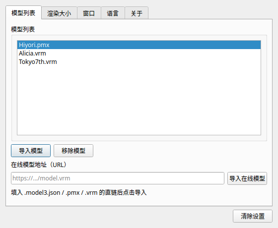

# 使用与配置

← [返回 README](../README.md) · [文档索引](README.md)

---

## 运行

```bash
./build/bin/ppet
```

首次启动会加载默认配置并显示设置面板。右键系统托盘图标可打开菜单。

> 桌宠是透明无边框窗口，**未加载模型时它本身就是完全不可见的** —— 这是预期行为，
> 不是 bug。首次启动或检测到「没有已配置模型」时会自动弹出设置面板，请在里面导入模型。

### 命令行参数（与日志相关）

```bash
./build/bin/ppet --log-level=trace              # 文件日志开到最细
./build/bin/ppet --log-console-level=debug     # 控制台也打印 DEBUG
```

详见 [调试与日志](debugging.md#日志级别与开关)。

---

## 托盘菜单

| 菜单项 | 快捷键 | 作用 |
| --- | --- | --- |
| 置顶 | `Ctrl+T` | **仅渲染窗口（桌宠本体）**始终在最上层；Qt 设置/诊断面板不随之置顶，切到其它应用会被正常覆盖 |
| 小工具 / 工具栏 | `Ctrl+B` | 显示/隐藏工具栏 |
| 忽略点击 | `Ctrl+I` | 点击穿透到下层窗口 |
| 配置 | `Ctrl+,` | 打开 Qt 设置面板 |
| **重置窗口位置** | — | 把窗口移到 `(0,0)`（主显示器左上角）并保存，用于窗口跑到桌面外时救回 |
| **移动窗口** | — | 开关：临时解除点击穿透，按住窗口即可拖动；再次点击结束并恢复穿透 |
| 上一个 / 下一个模型 | `Ctrl+P` / `Ctrl+N` | 在已导入模型间切换 |
| 导入模型 | `Ctrl+O` | 打开文件对话框（默认第一项是 `PMX 模型包 (*.zip)`） |
| **表情** | — | 子菜单：列出模型支持的表情预设（自然 / 开心 / 放松 / 生气 / 难过 / 惊讶；Live2D 列出表情动作组）。切换带平滑过渡，不会瞬间跳变 |
| **说一句** | — | 随机抽一条台词（问候 / 思考 / 工作 / 等待 / 成功 / 出错等状态），让桌宠主动开口 |
| **台词气泡** | — | 开关台词气泡。关掉后桌宠**照常动嘴**，只是不显示文字气泡 |
| 语言 | — | 简体中文 / English 子菜单 |
| 重新渲染 | `Ctrl+R` | 重新加载当前模型，重置骨骼与表情状态 |
| **模型诊断** | `Ctrl+Shift+D` | **合并后的唯一调试/分析入口**（原「调试 Ctrl+D」与「模型分析」二合一）：打开 Qt 诊断面板，同时把桌面尺寸、追踪状态、FPS 与模型摘要写入 `last.log`。见 [调试与日志](debugging.md#模型诊断面板)。**看不到模型时先看「实际出图 Pixels」**：为 `0.00% ← 未出图` 表示帧缓冲是空的 |
| 开机启动 | — | 注册/取消自启 |
| 反馈 / 关于 / 退出 | — | 打开 GitHub Issues / 设置面板关于页 / 退出 |

### 窗口位置与拖动

窗口是透明无边框的置顶窗口，**按住窗口任意位置拖动**即可移动，松手后位置写入配置。

如果窗口跑到桌面之外（`Win+Tab` 的任务视图里能看到，桌面上却够不着）：

1. 右键托盘图标 → **重置窗口位置**，窗口立刻回到 `(0,0)` 主显示器左上角；
2. 平时开着「忽略点击」时，勾选 **移动窗口** 临时解除穿透，再拖动微调；
3. 结束后再次点击「移动窗口」，穿透状态按当前配置恢复并保存位置。

程序会把所有程序化设置的位置（加载配置、拖动结束、托盘重置）钳制在虚拟桌面可见范围内，
多显示器的负坐标同样适用，因此窗口不会再被拖到看不见的地方。

---

## Live2D 待机与点击互动

Live2D 模型（`.model3.json` / `.moc3`）除了呼吸、眨眼、视线跟随，还会自动播放
`Motions` 里的动作，并响应鼠标点击。这套动作系统参考了原 ppet（Electron +
pixi-live2d-display）与 Touhou Desktop Pet 的组织方式：

| 行为 | 说明 |
| --- | --- |
| **待机动作** | `Idle` 组里的动作按随机间隔（约 3~7 秒）循环随机播放，叠加在呼吸/眨眼/视线之上 |
| **点击互动** | 点击角色不同部位，按 `HitAreas` 命中区触发对应的 `TapHead` / `TapBody` / `Pinch*` / `Shake*` 等互动动作；没有命中区定义时按包围盒空间分区（头/身/腿/左/右）回退 |
| **优先级打断** | 互动动作优先级高于待机，会打断当前 Idle 并淡入；播放结束回落到待机循环 |
| **淡入淡出** | 动作切换用 `FadeInTime` / `FadeOutTime` 与待机基线平滑混合，避免姿态跳变。优先读 `motion3.json` 的 `Meta`，缺失时回退到 `model3.json` 组条目上的值 |

> 点击互动的前提是**窗口能收到鼠标事件**：开着「忽略点击」时事件会被穿透到下层，
> 先关闭它（或勾选「移动窗口」）再点击。拖动窗口不会误触发互动动作。
>
> 「模型诊断」面板的**概览 → 动作系统**分组会实时显示当前动作状态、动作组与命中区。

实现见 `api/live2d/MotionDirector.hpp`（纯逻辑调度器，可脱离 Cubism SDK 单测）与
[项目结构](architecture.md)。

---

## 表情与台词

桌宠会**自己说话**，也会**换表情**：

| 行为 | 触发方式 | 说明 |
| --- | --- | --- |
| **换表情** | 托盘 → **表情** → 选择预设 | 自然 / 开心 / 放松 / 生气 / 难过 / 惊讶。切换用 `smoothstep` 平滑过渡，不会瞬间跳变；自动眨眼是独立叠层，不会覆盖你选的表情 |
| **主动说话** | 托盘 → **说一句** | 随机抽一条台词（问候 / 思考 / 工作 / 等待 / 成功 / 出错） |
| **打招呼** | **点击桌宠** | 自动说一句问候，并同步口型 |
| **待机碎碎念** | 自动 | 每 12~25 秒随机说一句，说完有冷却 |
| **口型同步** | 自动 | 说话时开口度按**音节包络**起伏（不是匀速张嘴），并切换 `aa`/`ih`/`ou`/`ee`/`oh` 元音嘴形；成功 / 问候时嘴角上扬，出错时嘴角下压 |

台词气泡显示在桌宠窗口**上方**，是独立的 Qt 窗口，无边框。
它**不抢置顶**（置顶只作用于桌宠本体），因此不会盖住你正在操作的其他窗口。

> 台词超过 24 个字符会按 **UTF-8 码点**截断并补 `…`，不会把汉字劈成乱码。

完整的预设表、别名规则（`happy` / `joy` / `笑い` / `开心` 都能命中同一个逻辑通道）、
气泡优先级与冷却规则见 **[表情管理与语言功能](expressions.md)**。

> 想看当前表情 / 台词 / 口型的实时数值：托盘 → **模型诊断** → **表情与说话** 页签。

---

## 设置面板

点击托盘菜单「配置」打开 Qt 设置窗口：



- **模型列表**：显示已导入模型与类型徽章，可切换 / 删除
- **导入模型**：选择 `.zip`（推荐）/ `.pmx` / `.vrm` / `.json` 文件
- **导入在线模型**：输入模型 URL
- **渲染大小**：0.25× ~ 4.0×
- **全屏追踪**：开关 + 追踪半径 + 最大偏转角度
- **窗口置顶 / 忽略鼠标点击 / 显示工具栏**
- **语言**、**清除设置**

> PMX 模型请优先选 `.zip`：`.pmx` 本身不含贴图，单独导入通常得到白模。
> 详见 [模型格式与导入](models.md#pmx-请用-zip-导入重要)。

---

## 全屏追踪

开启后，模型会跟随**整个屏幕（含多显示器）**的光标朝向，而不只是在窗口内。

- **追踪半径**（`trackingRadius`，像素）：光标距模型该距离时朝向达到最大偏转；值越大，跟随越「迟钝」。
- **最大偏转角度**（`maxTrackingAngle`，度）：头部/眼球的最大转动幅度。

实现方式（按平台）：

| 平台 | 全局光标获取 |
| --- | --- |
| Windows | `SetWindowsHookEx(WH_MOUSE_LL)` 低级鼠标钩子 |
| macOS | `NSEvent` 全局监视器（AppKit） |
| Linux | X11 `XRecord` 扩展；不可用时退化为轮询 `XQueryPointer` |

追踪器不可用时会自动降级为窗口内跟随，并在日志里记一条 ERROR，不影响启动。

---

## 配置

配置以 JSON 持久化在用户配置目录（如 Linux 上为 `~/.config/PPet/ppet.json`）。常用字段：

| 字段 | 含义 | 默认 |
| --- | --- | --- |
| `fullscreenTracking` | 是否启用全屏追踪 | `true` |
| `trackingRadius` | 追踪半径（像素） | `400` |
| `maxTrackingAngle` | 最大偏转角度（度） | `30` |
| `renderScale` | 渲染缩放 | `1.0` |
| `alwaysOnTop` | 窗口置顶 | `true` |
| `ignoreMouseEvents` | 点击穿透 | `false` |
| `showTool` | 显示工具栏 | `true` |
| `openAtLogin` | 开机启动 | `false` |
| `language` | 界面语言 | `Chinese` |
| `modelPath` | 当前模型路径（zip 导入时是解压后的模型文件） | `""` |
| `modelList` | 已导入模型列表 | `[]` |

字段缺失时使用默认值，旧版本配置文件可以直接加载。数值越界会自动回退到合法范围。

---

## 界面语言

托盘菜单「语言」可在简体中文 / English 间切换，设置面板与诊断面板的文案会立即刷新。
文案本体放在 `Compiler/i18n/{zh-CN,en-US}.json`，由构建期的[文案翻译器](../Compiler/README.md)
生成 C++ 内嵌表，运行时零成本。
